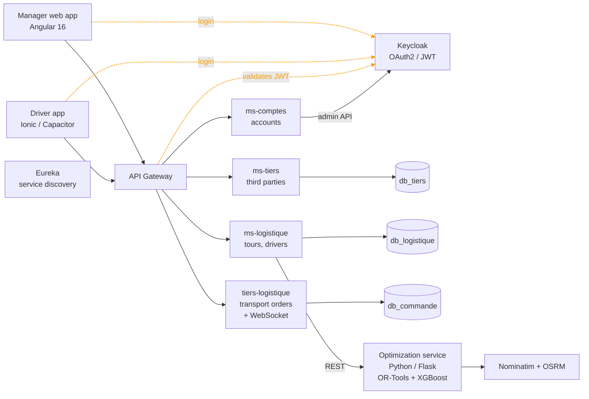
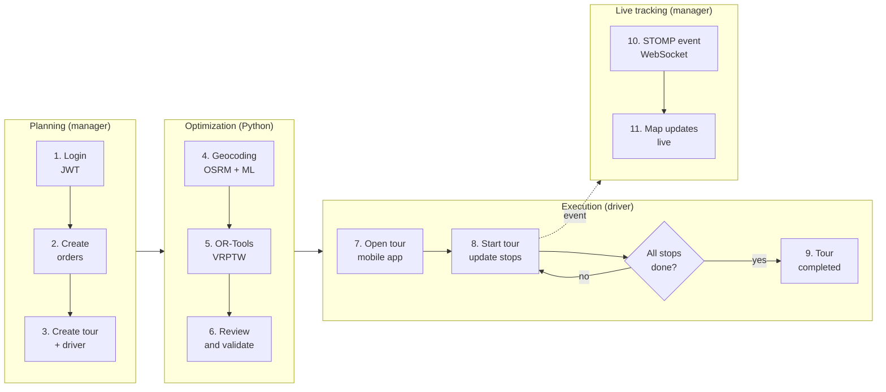
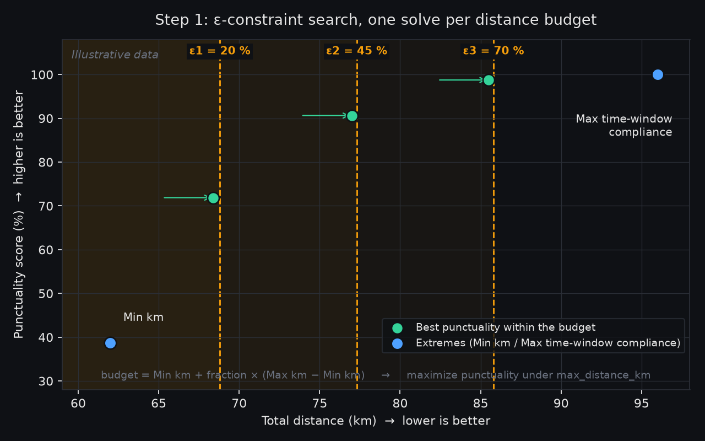
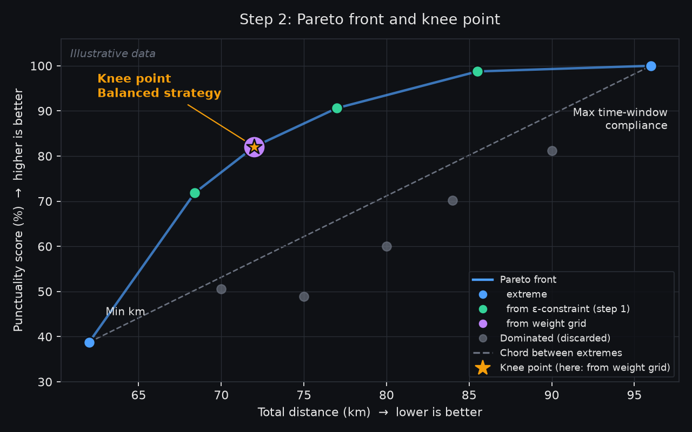

# TMS – Transport Management System

**At a glance**

- **Problem:** planning delivery tours by hand is slow, and late arrivals are hard to anticipate or follow.
- **Solution:** a web and mobile platform where managers enter orders, get an optimized stop sequence that respects client time windows, and follow each tour live on a map.
- **Highlights:** Spring Boot microservices behind an API gateway with Eureka discovery and Keycloak (OAuth2/JWT), a Python route-optimization service (OR-Tools VRPTW, multi-objective search, XGBoost), real-time tracking over WebSocket, an Angular web app and an Ionic driver app.

A platform to **plan, optimize, and track transport tours**, from order entry to the driver's phone. Managers create orders and tours, an optimization engine proposes the best stop sequence, and drivers execute the tour from a mobile app while managers follow it live on a map.

> The source code is private. This document describes the architecture and the main technical choices.

## Architecture

Each microservice has its own responsibility and its own database. All traffic goes through the gateway, which authenticates the user and routes requests to services registered in Eureka.

## Application workflow

## Services

| Service | Role | Port |
|---|---|---|
| api-gateway | Single entry point: routing, JWT validation, CORS, WebSocket proxy | 8080 |
| eureka-server | Service registry | 8761 |
| ms-tiers | Third parties (clients, carriers) | 8081 |
| tiers-logistique | Transport orders (order → detail → line / product / article), PDF export, real-time events | 8082 |
| ms-logistique | Tours and drivers, calls the optimizer | 8083 |
| ms-comptes | Accounts via the Keycloak admin API, invitation emails | 8085 |
| optimization-python-service | Route optimization and ML | 5000 |
| front / driver-app | Angular 16 web app / Ionic + Capacitor mobile app | – |

## Security

- **Keycloak** issues JWTs. Every service is an OAuth2 resource server that validates them and maps realm roles (`MANAGER`, `LOGISTICS_MANAGER`, driver) to access rules.
- **Gateway-only access:** the gateway adds a secret header to forwarded requests, and each service rejects requests without it (`403`). Direct calls that bypass the gateway are blocked.

## Route optimization

A Flask service solves a **VRPTW** (Vehicle Routing Problem with Time Windows) with Google OR-Tools.

- **Constraints:** a hard tour window, soft client time windows (high lateness penalty), pickup/delivery pairs, and vehicle capacity.
- **Priorities:** client time slots, then total duration, then distance.
- **Strategies:** minimum distance, maximum time-window compliance, and a balanced route chosen with an ε-constraint search and a Pareto-front knee point.
- **ML (XGBoost):** one model corrects OSRM travel times by hour, weekday, zone type, and truck type. Another predicts tour duration and delay risk. Both are trained on synthetic data.
- **Geo:** Nominatim geocoding with a persistent cache, OSRM distance matrices and route geometry.

*How the **balanced** strategy is built (the two extremes, minimum distance and maximum time-window compliance, are solved directly). Step 1, generate candidates: the optimizer fixes a distance budget (20 %, 45 % and 70 % of the gap between the shortest and the most punctual route) and maximizes punctuality under that cap. Each budget gives one intermediate route (green). Further candidates come from a weight grid that blends the two objectives with different weights. Illustrative data.*

*Step 2, filter and choose: the routes from step 1 (green) join the two extremes and the weight-grid candidates. Any route beaten on both distance and punctuality is discarded (grey), which leaves the Pareto front. The knee point, the front point farthest from the chord joining the two extremes, becomes the balanced route. Axes are normalized before the knee is computed. Same illustrative data as step 1.*

## Real-time tracking

When a driver starts a tour, `tiers-logistique` updates the state and publishes an event on a STOMP topic (WebSocket via the gateway). The manager's map updates without refreshing.

## Design choices

- **Database per service**, with data shared through APIs only.
- **Command/query separation** in the transport-order service: write handlers validate the whole aggregate in one transaction, and read-only query services return dedicated DTOs. It is a lightweight approach, with the same entities and database and no event sourcing.
- **Ports and adapters** for calls to other services.

## Tech stack

Java 17, Spring Boot 3.5, Spring Cloud (Gateway, Eureka), Spring Security, JPA, WebSocket, MapStruct, PostgreSQL, Keycloak, Python, Flask, OR-Tools, XGBoost, scikit-learn, Angular, Leaflet, Chart.js, Ionic, Capacitor, Docker Compose, Maven.
